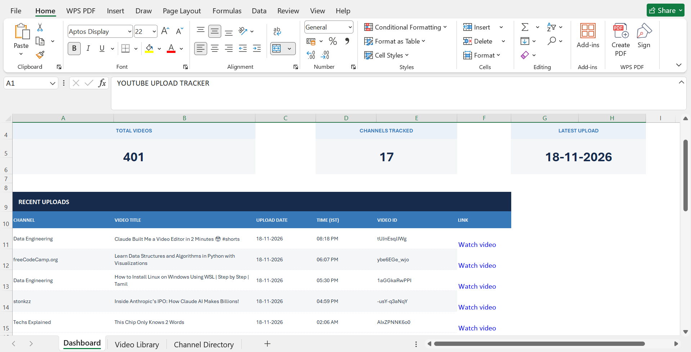

# YouTube Upload Tracker

A Python-based automation tool that monitors multiple YouTube channels, detects newly uploaded videos, sends desktop notifications, and maintains an Excel-based video database.

## Overview

The YouTube Upload Tracker helps users stay updated with their favourite YouTube channels without manually checking each channel.

It uses YouTube RSS feeds to monitor channel uploads at regular intervals and automatically records new video information in an Excel workbook.

## Features

- **Multiple Channel Monitoring** – Track multiple YouTube channels simultaneously.
- **Automatic Upload Detection** – Detect newly uploaded videos using YouTube RSS feeds.
- **Desktop Notifications** – Receive Windows desktop notifications when new videos are detected.
- **Excel Integration** – Automatically store video details in an Excel workbook.
- **Dashboard** – View collected video information through an organized Excel dashboard.
- **Automated Monitoring** – Check for new uploads at regular 5-minute intervals.
- **Duplicate Prevention** – Avoid adding the same video multiple times.

## Technologies Used

- Python 3.11
- YouTube RSS Feeds
- Feedparser
- OpenPyXL
- Winotify
- Microsoft Excel

## Project Structure

```text
youtube-upload-tracker/
│
├── main.py
├── monitor.py
├── format_excel.py
├── channels.txt
├── requirements.txt
├── README.md
├── .gitignore
│
└── screenshots/
    ├── dashboard.png
    └── terminal.png
```

## Output

The tracker maintains an Excel workbook containing collected video information, including:

- Channel Name
- Video Title
- Video ID
- Published Date
- Published Time
- Video URL

The Excel dashboard provides an organized view of collected uploads.

## Screenshots

### Excel Dashboard



### Terminal Monitoring


## Future Improvements

- Video thumbnail integration
- Search and filter functionality
- Advanced upload analytics
- Custom keyword-based alerts
- Desktop application interface

## Important Notes

- An active internet connection is required.
- Monitoring works while the Python script is running.
- YouTube RSS feeds provide recent upload information, not a complete historical archive.
- Desktop notifications require a supported Windows notification environment.

## Author

**Muhammad Ajmal**

Electronics and Communication Engineering 

---

If you find this project useful, feel free to star the repository!
